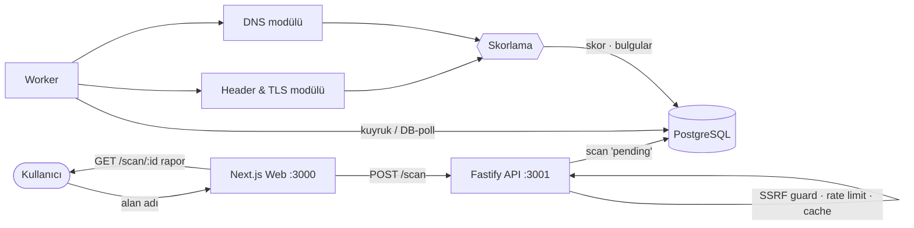

<div align="center">


# CatDef 🐱🛡️

**Pasif web güvenlik tarayıcısı — bir alan adı girin, saniyeler içinde anlaşılır Türkçe bir güvenlik raporu ve A–F notu alın.**

*A passive web security scanner — enter a domain, get a plain‑language security report and an A–F grade in seconds.*


[Türkçe](#-türkçe) · [English](#-english)

</div>

---

## 🇹🇷 Türkçe

CatDef, bir web sitesini **pasif olarak** (yalnızca dışarıdan gözlemleyerek, saldırı/sömürü yapmadan) tarar ve HTTPS, güvenlik başlıkları, TLS sertifikası ve DNS/e‑posta hijyeni için **yeni başlayanın da anlayacağı Türkçe** bir rapor üretir. Her bulgu; kabul görmüş güvenlik standartlarına (OWASP Top 10, CWE, ASVS) eşlenir ve platforma özel **kopyala‑yapıştır düzeltme** adımlarıyla gelir.

> Mimari karar, kapsam ve yol haritasının tamamı `proje_plani.md` dosyasındadır. Bu depo şu an **Faz 0–2**'yi içerir.

### ✨ Öne çıkanlar

- **Anlaşılır Türkçe rapor** — her bulguda "bu ne demek?", "neden önemli?" ve yanlış‑pozitif notu.
- **Standart eşlemesi** — OWASP Top 10 2025 **+** 2021 çapraz referans, CWE ve ASVS 5.0 (bkz. [`docs/SCORING.md`](docs/SCORING.md)).
- **Düzeltme rehberleri** — Nginx, Apache, Express, Next.js, Vercel, Cloudflare ve DNS için kopyala‑yapıştır yapılandırma + pasif "düzeldi mi?" doğrulaması.
- **Şeffaf skorlama** — kategori‑ağırlıklı, normalize edilen, birim testli bir model.
- **Güvenli tasarım** — SSRF koruması, IP başına günlük rate limit, 24 saatlik cache, tam audit log.
- **Sıfır kurulum** — Docker/Postgres/Redis olmadan tek komutla çalışır (`pnpm dev:local`).

### 🏗️ Mimari

pnpm + Turborepo monorepo:

| Paket | Rol |
|---|---|
| `packages/shared` | Ortak tipler, skorlama, bulgu kataloğu + standart eşlemesi, düzeltme rehberleri, SSRF guard |
| `apps/api` | Fastify — tarama uç noktaları, rate limit, cache, SSRF guard |
| `apps/worker` | Header/TLS ve DNS modülleri, skorlama, veritabanı yazımı |
| `apps/web` | Next.js — tarama formu + SSR paylaşılabilir rapor sayfası |



### 🚀 Hızlı başlangıç (önerilen: sıfır kurulum)

Docker/Postgres/Redis **gerekmez**. Yerel mod, gerçek bir Postgres'i (`embedded-postgres`) süreç içinde başlatır ve iş kuyruğunu DB‑polling ile çalıştırır.

```bash
corepack enable
pnpm install
pnpm dev:local
```

- Web: http://localhost:3000
- API: http://localhost:3001/health
- Yerel veritabanı `.devdata/` altında kalıcıdır (git'e girmez). Durdurmak: `Ctrl+C`.

### 🐳 Alternatif: Docker ile (üretime yakın)

Gerçek Postgres **+** Redis/BullMQ akışını denemek için:

```bash
docker compose up -d        # Postgres + Redis
pnpm db:migrate             # şema (5 tablo)
pnpm dev                    # api + worker + web
```

> Yerel mod `CATDEF_LOCAL=1` bayrağıyla ayrışır; Redis/BullMQ yalnızca bu bayrak **yokken** devreye girer.

### ✅ Doğrulama

```bash
pnpm test     # birim testleri (skorlama + katalog bütünlüğü)
pnpm build    # tüm paketlerde tip kontrolü + derleme
```

**Uçtan uca:** Web'de bir alan adı girin → `/report/[scanId]` sayfasına yönlenir → tarama bitince harf notu, bulgular, standart etiketleri ve her bulgu için düzeltme rehberi görünür.

### 🔒 Güvenlik ve etik

- **Pasiftir:** yalnızca herkese açık, pasif gözlem yapar; zafiyet sömürmez, yük bindirmez.
- **SSRF koruması:** iç/özel/metadata IP'lerine (localhost, 10.x, 192.168.x, 169.254.169.254 …) çözülen alan adları taranmadan reddedilir ve `audit_log`'a yazılır.
- **Yalnızca yetkili tarama:** sahibi olduğunuz veya test izniniz olan siteleri tarayın.

> Aracın kendi tehdit modeli ve SSRF sağlamlaştırma testleri sonraki fazda `docs/THREAT_MODEL.md` ve `docs/SECURITY_TESTING.md` altında belgelenecektir.

### 🗺️ Yol haritası

- [x] **Faz 0** — MVP: Header/TLS + DNS modülleri, skorlama, SSR rapor, sıfır kurulum.
- [x] **Faz 1** — Metodoloji: OWASP/CWE/ASVS eşlemesi, `docs/SCORING.md`.
- [x] **Faz 2** — Platforma özel düzeltme rehberleri + doğrulama.
- [ ] **Faz 3** — Tehdit modeli + kapsamlı SSRF bypass test paketi.
- [ ] **Faz 4** — CI (lint/typecheck/test/CodeQL), Dependabot, test kapsamı.
- [ ] **Sonraki** — Exposure/CVE modülleri, kullanıcı hesapları, gömülebilir güven rozeti.

---

## 🇬🇧 English

CatDef is a **passive** web security scanner: it observes a site from the outside (no exploitation, no load) and produces a **plain‑language report** covering HTTPS, security headers, the TLS certificate and DNS/email hygiene, with an A–F grade. Every finding is mapped to recognised standards (**OWASP Top 10 2025 + 2021, CWE, ASVS 5.0**) and ships with **copy‑paste remediation** for Nginx, Apache, Express, Next.js, Vercel, Cloudflare and DNS.

> The report UI is in Turkish by design — the target audience is Turkish‑speaking developers. The code, docs and architecture are documented in both languages.

### Highlights

- Plain‑language findings with "why it matters" and false‑positive notes.
- Standards mapping (see [`docs/SCORING.md`](docs/SCORING.md)) and a transparent, unit‑tested scoring model.
- Per‑platform remediation guides with a passive "did it get fixed?" check.
- Secure by design: SSRF guard, per‑IP daily rate limit, 24h cache, full audit log.
- **Zero external dependencies to run** — no Docker/Postgres/Redis needed.

### Quick start

```bash
corepack enable
pnpm install
pnpm dev:local     # starts an in-process Postgres + api + worker + web
```

- Web: http://localhost:3000 · API: http://localhost:3001/health
- Verify with `pnpm test` and `pnpm build`.

### Architecture

A pnpm + Turborepo monorepo: `packages/shared` (types, scoring, findings catalog + standards, remediation, SSRF guard), `apps/api` (Fastify), `apps/worker` (Header/TLS + DNS modules), `apps/web` (Next.js SSR report). See the diagram in the Turkish section above.

### Security & ethics

Passive observation only; scan only domains you own or are authorised to test. Domains resolving to internal/private/metadata IPs are rejected before any request and logged to `audit_log`.

### Roadmap

Phase 0–2 complete (MVP, standards methodology, remediation guides). Next: threat model + SSRF bypass test suite (Phase 3), CI/CodeQL/Dependabot (Phase 4), then exposure/CVE modules and an embeddable trust badge.

---

<div align="center">
<sub>CatDef · pasif web güvenlik tarayıcısı · eğitim ve portfolyo amaçlı</sub>
</div>
